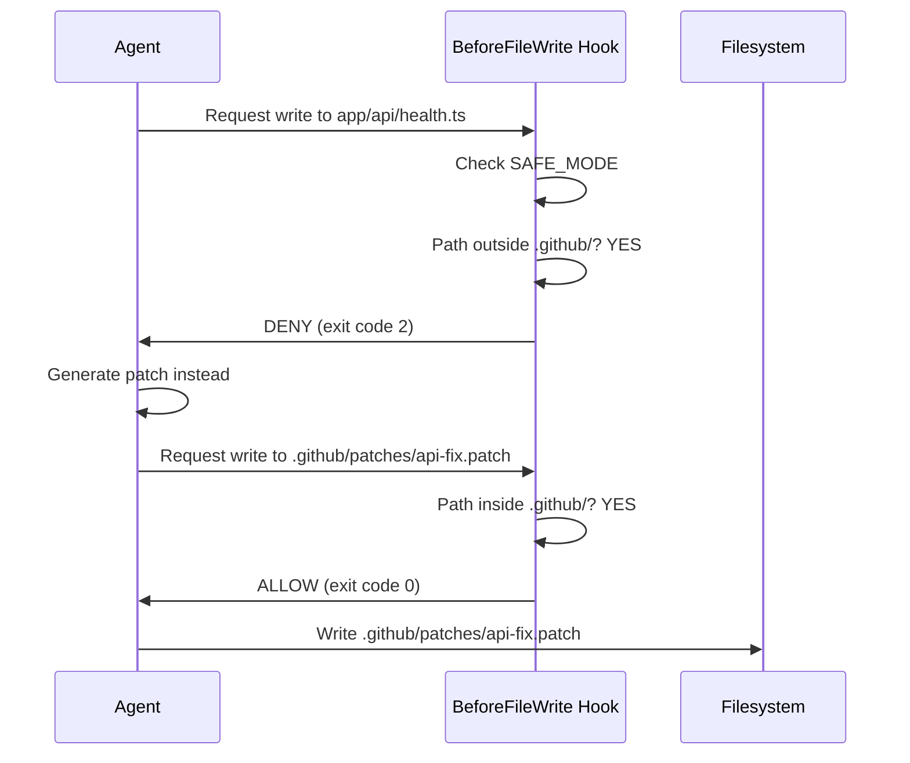

# VS Code GitHub Copilot Agent Mode - Usage Guide
# Integration with SUPER-AGENT v3 Framework

**Target**: VS Code GitHub Copilot with Claude Opus 4.6  
**Framework**: SUPER-AGENT v3 (Cape Town GeoHub)  
**Date**: 2026-02-10

---

## 🎯 Quick Start (60 seconds)

### 1. Open VS Code with Your Project

```bash
cd /path/to/cape-town-geohub
code .
```

### 2. Activate GitHub Copilot Agent Mode

```
# In VS Code Chat panel (Ctrl+Alt+I or Cmd+Alt+I)

@workspace Hello! I need you to work on a long task following our 
SUPER-AGENT v3 framework. Please:

1. Load .github/AGENTS.md
2. Load .github/copilot-instructions.md  
3. Load .github/agent-manifest.json
4. Review all skills in .github/skills/
5. Initialize using BeforeAgent hook

Then I'll give you the main task.
```

### 3. Provide the Task

```
@workspace [Paste the entire vscode-copilot-agent-task.md content here]
```

### 4. Monitor Progress

- Watch the Chat panel for agent updates
- Check `.github/patches/` directory for generated patches
- Monitor `.github/hooks/audit.log` for hook decisions
- Review `.github/findings.json` for issues found

---

## 🧠 Understanding Agent Mode vs. Chat Mode

### Chat Mode (Default)
```
User: How do I fix this API error?
Copilot: [Provides explanation and code snippet]
```
- Single-turn interactions
- No context persistence
- No file generation
- Manual code application

### Agent Mode (With @workspace)
```
User: @workspace Fix all API errors following SUPER-AGENT v3 protocol
Copilot: [Initializes framework, loads context, executes multi-phase plan]
```
- Multi-turn autonomous execution
- Context from `.github/` framework
- Automatic patch generation
- Hook/policy enforcement
- Memory persistence

---

## 📋 SUPER-AGENT v3 Framework Overview

### Core Components

```
.github/
├── AGENTS.md                    # Main agent instructions
├── copilot-instructions.md      # Copilot-specific config
├── agent-manifest.json          # Repository structure map
├── agent-memory/                # State persistence
│   ├── session_memory.json      # Current task state
│   ├── project_memory.json      # Project-wide learnings
│   └── global_agent_memory.json # Cross-project knowledge
├── skills/                      # Reusable capabilities
│   ├── api-adapter/
│   ├── dep-guardian/
│   ├── design-linter/
│   ├── ui-crawler/
│   ├── refactor-strategist/
│   └── accessibility-auditor/
├── hooks/                       # Lifecycle enforcement
│   ├── BeforeAgent.js
│   ├── BeforeTool.js
│   ├── AfterTool.js
│   ├── BeforeFileWrite.js
│   └── AfterExecution.js
├── policies/                    # Rules as code
│   ├── no-secrets.yaml
│   ├── dependency-allowlist.yaml
│   ├── max-pr-size.yaml
│   └── protected-files.yaml
├── scripts/                     # Verification tools
│   ├── verify.sh
│   └── policy_check.js
└── patches/                     # Generated fixes (SAFE_MODE)
```

### Agent Workflow

```
┌──────────────┐
│ User Request │
└──────┬───────┘
       │
       ▼
┌──────────────────┐
│ BeforeAgent Hook │ ← Initialize memory, load context
└──────┬───────────┘
       │
       ▼
┌──────────────────┐
│  Load Framework  │ ← AGENTS.md, copilot-instructions.md
└──────┬───────────┘
       │
       ▼
┌──────────────────┐
│  Execute Task    │ ← Multi-phase execution
└──────┬───────────┘
       │
       ▼
┌──────────────────┐
│ BeforeTool Hook  │ ← Validate each tool call
└──────┬───────────┘
       │
       ▼
┌──────────────────┐
│   Use Skill      │ ← api-adapter, refactor-strategist, etc.
└──────┬───────────┘
       │
       ▼
┌──────────────────┐
│  AfterTool Hook  │ ← Update memory, run tests
└──────┬───────────┘
       │
       ▼
┌──────────────────────┐
│ BeforeFileWrite Hook │ ← SAFE_MODE enforcement
└──────┬───────────────┘
       │
       ▼
┌──────────────────┐
│ Generate Patches │ ← .github/patches/*.patch
└──────┬───────────┘
       │
       ▼
┌────────────────────┐
│ AfterExecution Hook│ ← Finalize, update memory
└──────┬─────────────┘
       │
       ▼
┌──────────────────┐
│ Deliver Results  │
└──────────────────┘
```

---

## 🛠️ Key VS Code Copilot Commands

### Workspace Commands

```typescript
// Load files into context
@workspace /loadFiles .github/AGENTS.md
@workspace /loadFiles .github/copilot-instructions.md
@workspace /loadFiles .github/skills/api-adapter/SKILL.md

// Search across workspace
@workspace /search "ERR_CONNECTION_RESET" --include="**/*.log"
@workspace /search "useEffect" --include="frontend/src/**/*.tsx"

// Explain architecture
@workspace /explain .github/agent-manifest.json
@workspace /explain app/api/health.ts

// Invoke skills (custom syntax)
@workspace /invoke-skill api-adapter diagnose --endpoints="/api/health"
@workspace /invoke-skill refactor-strategist analyze --component="App.tsx"

// Generate documentation
@workspace /generate-docs .github/patches/
```

### Terminal Integration

```bash
# Run commands from chat
@terminal npm run dev
@terminal curl http://localhost:5174/api/health
@terminal docker-compose logs api-gateway

# Execute hooks
@terminal node .github/hooks/BeforeAgent.js
@terminal bash .github/scripts/verify.sh
```

### File Operations

```typescript
// Create files (respects SAFE_MODE)
@workspace Create .github/patches/new-fix.patch with:
[patch content]

// Edit files (only .github/ allowed in SAFE_MODE)
@workspace Edit .github/findings.json to add new finding:
{ "id": "f-0015", ... }

// Read files
@workspace Show me .github/agent-memory/session_memory.json
```

---

## 🎯 Task Execution Patterns

### Pattern 1: Diagnostic + Fix

```
User: @workspace Diagnose why /api/health is returning 500 errors

Agent:
1. Loading .github/AGENTS.md framework
2. Executing BeforeAgent hook
3. Invoking api-adapter skill
4. Analyzing logs and code
5. Generating .github/patches/api-health-fix.patch
6. Running tests
7. Updating findings

[Detailed execution steps...]
```

### Pattern 2: Multi-Component Refactor

```
User: @workspace Fix infinite loops in App.tsx, OpsStatus.tsx, Dashboard.tsx

Agent:
1. Loading SUPER-AGENT v3 context
2. Invoking refactor-strategist skill
3. Analyzing each component
4. Generating separate patches:
   - .github/patches/app-tsx-fix.patch
   - .github/patches/opsstatus-fix.patch
   - .github/patches/dashboard-fix.patch
5. Running component tests
6. Checking policies
7. Updating memory

[Detailed execution...]
```

### Pattern 3: Feature Addition

```
User: @workspace Enable all MapView data layers with PostGIS clustering

Agent:
1. Initializing agent framework
2. Invoking ui-crawler skill to map current structure
3. Invoking api-adapter skill to generate layer types
4. Generating layer implementation patches
5. Invoking accessibility-auditor for WCAG compliance
6. Running performance tests
7. Generating documentation

[Detailed execution...]
```

---

## 🔧 Working with Skills

### Listing Available Skills

```
User: @workspace What skills do we have?

Agent: According to .github/agent-manifest.json, we have:

1. **api-adapter**: API diagnostics, SDK generation, contract validation
2. **dep-guardian**: Dependency updates, license checks, vulnerability scanning
3. **design-linter**: UI consistency, design token validation
4. **ui-crawler**: Browser automation, element discovery, visual regression
5. **refactor-strategist**: Safe refactoring, rollback scripts
6. **accessibility-auditor**: WCAG compliance, remediation patches
7. **pr-reviewer**: PR validation, test coverage, security checks
```

### Using a Skill

```
User: @workspace Use api-adapter to diagnose all failing API endpoints

Agent: Invoking api-adapter skill...

Running: .github/skills/api-adapter/scripts/diagnose.sh
Parameters:
  - endpoints: [/api/health, /api/data-status/health, ...]
  - log_level: debug
  - output: .github/patches/api-diagnostics.json

Results:
[Diagnostic output...]

Generated: .github/patches/api-diagnostics.json
Next steps: Generate fix patches based on diagnostics
```

### Creating a Custom Skill

```
User: @workspace Create a new skill for GraphQL schema validation

Agent: Creating new skill under .github/skills/graphql-validator/

Generated:
- .github/skills/graphql-validator/SKILL.md
- .github/skills/graphql-validator/scripts/validate.sh
- .github/skills/graphql-validator/tests/test_validation.sh
- .github/skills/graphql-validator/config.yaml

Updated .github/agent-manifest.json to register new skill

Skill ready to use!
```

---

## 🚨 SAFE_MODE Explained

### What is SAFE_MODE?

SAFE_MODE is a constraint that prevents the agent from directly modifying application code. Instead, it generates **patches** that humans review and apply.

### Allowed Operations (SAFE_MODE = true)

✅ **Write to `.github/` directory**
```
.github/patches/api-fix.patch          ← Allowed
.github/findings.json                  ← Allowed
.github/agent-memory/session_memory.json ← Allowed
```

✅ **Read from anywhere**
```
app/api/health.ts                      ← Can read
frontend/src/components/App.tsx        ← Can read
backend/config/database.py             ← Can read
```

✅ **Run commands** (non-destructive)
```
npm run test                           ← Allowed
pytest tests/                          ← Allowed
curl http://localhost:5174/api/health  ← Allowed
```

### Forbidden Operations (SAFE_MODE = true)

❌ **Direct writes outside `.github/`**
```
app/api/health.ts                      ← Blocked
frontend/src/components/App.tsx        ← Blocked
backend/database.py                    ← Blocked
```

❌ **Destructive commands**
```
rm -rf /                               ← Blocked
sudo reboot                            ← Blocked
git push --force                       ← Blocked (needs approval)
```

### How SAFE_MODE Works



### Disabling SAFE_MODE (Use with Caution)

```bash
# Set environment variable
export SAFE_MODE=false

# Or in agent initialization
@workspace Initialize agent with SAFE_MODE=false for this session

# Agent will now be able to modify code directly
# Use ONLY when you trust the changes and can review in real-time
```

**Warning**: Disabling SAFE_MODE allows the agent to modify your codebase directly. Only do this if:
- You're actively monitoring the agent
- You have version control (git)
- You can quickly revert changes
- The task is low-risk

---

## 🎓 Best Practices

### 1. Always Load Framework First

```
❌ Bad:
User: Fix the API errors

✅ Good:
User: @workspace Load SUPER-AGENT v3 framework, then fix API errors
```

### 2. Be Specific About Constraints

```
❌ Bad:
User: @workspace Refactor the components

✅ Good:
User: @workspace Refactor App.tsx, OpsStatus.tsx, Dashboard.tsx
following SAFE_MODE constraints. Generate patches only.
```

### 3. Reference Documentation

```
✅ Good:
User: @workspace Fix MapView layers according to .github/AGENTS.md
section 4.2 (Map Layer Requirements)
```

### 4. Validate Incrementally

```
✅ Good:
User: @workspace After each fix, run tests and update findings.json
Don't proceed to next fix until current one passes.
```

### 5. Use Memory Effectively

```
✅ Good:
User: @workspace Review session_memory.json for previous attempts.
Don't repeat solutions that failed.
```

### 6. Leverage Skills

```
❌ Bad:
User: @workspace Write code to check API security

✅ Good:
User: @workspace Use pr-reviewer skill to audit API security
```

---

## 🔍 Monitoring Agent Progress

### Real-Time Monitoring

**Terminal 1: Watch Patches**
```bash
watch -n 2 'ls -lth .github/patches/ | head -20'
```

**Terminal 2: Monitor Hooks**
```bash
tail -f .github/hooks/audit.log | jq
```

**Terminal 3: Track Findings**
```bash
watch -n 5 'jq ".summary" .github/findings.json'
```

**VS Code: Open Files**
- `.github/agent-memory/session_memory.json` (auto-refresh enabled)
- `.github/findings.json`
- `.github/patches/` directory

### Checkpoints

Ask the agent for status updates:

```
User: @workspace Status update: What have you completed and what's next?

Agent: 
✅ Completed:
- Phase 1: Infrastructure analysis
- Phase 2: API Gateway fixes (6/6 endpoints)
- Phase 3: React component fixes (3/3 components)

🔄 In Progress:
- Phase 4: MapView layer integration (3/5 layers enabled)

📋 Next:
- Complete heatmap and route layers
- Run performance tests
- Generate documentation

Patches generated: 18/30 estimated
```

---

## 🐛 Troubleshooting

### Agent Not Respecting SAFE_MODE

**Symptom**: Agent tries to edit `app/api/health.ts` directly

**Solution**:
```
User: @workspace STOP. You violated SAFE_MODE by trying to write 
outside .github/. Review .github/AGENTS.md section on SAFE_MODE.
Generate patches only.
```

### Agent Doesn't Load Framework

**Symptom**: Agent proceeds without loading `.github/` context

**Solution**:
```
User: @workspace Before continuing, you MUST:
1. Load .github/AGENTS.md
2. Load .github/copilot-instructions.md
3. Execute BeforeAgent hook
4. Acknowledge framework loaded

Then we can proceed.
```

### Hooks Not Executing

**Symptom**: `BeforeAgent.js` returns error

**Solution**:
```bash
# Test hook manually
echo '{"agent_id": "test"}' | node .github/hooks/BeforeAgent.js

# Check permissions
chmod +x .github/hooks/*.js

# Install dependencies
cd .github/hooks && npm install

# In Copilot chat
User: @workspace The BeforeAgent hook is failing. Debug it.
```

### Skills Not Found

**Symptom**: `api-adapter skill not found`

**Solution**:
```bash
# Verify skill exists
ls -la .github/skills/api-adapter/

# In Copilot chat
User: @workspace Reload workspace and re-index .github/skills/
```

### Patches Not Applying

**Symptom**: `git apply` fails with conflicts

**Solution**:
```bash
# Check what changed
git status

# Apply patches one by one
git apply --check .github/patches/001-*.patch
git apply .github/patches/001-*.patch

# Or ask agent to regenerate
User: @workspace The patch 001-api-fix.patch conflicts with current
code. Regenerate based on latest file state.
```

---

## 📊 Performance Tips

### Optimize Context Loading

```
❌ Slow:
@workspace Load all files in app/ and frontend/

✅ Fast:
@workspace Load only:
- .github/AGENTS.md
- app/api/health.ts
- app/api/data-status/health.ts
(specific files relevant to task)
```

### Use Incremental Execution

```
✅ Efficient:
User: @workspace Fix API Gateway in 3 phases:
Phase 1: Health endpoints only (15 min)
Phase 2: Geocode endpoints (20 min)  
Phase 3: Dashboard endpoints (15 min)

After each phase, validate and update memory before proceeding.
```

### Leverage Caching

```
✅ Smart:
User: @workspace Cache the PostGIS diagnostic results in 
.github/patches/postgis-diagnostics.json so we don't re-run
expensive queries.
```

---

## 🎉 Example End-to-End Session

### Complete Session Transcript

```
[User opens VS Code Copilot Chat]

User: @workspace Hello! I need you to fix our MapView integration
following SUPER-AGENT v3 framework.

Copilot: I'll help you fix the MapView integration. Let me start by
loading the SUPER-AGENT v3 framework.

[Loads .github/AGENTS.md, copilot-instructions.md, agent-manifest.json]

Framework loaded successfully. I see we have 7 skills available.
What specific issues are you experiencing with MapView?

User: [Pastes vscode-copilot-agent-task.md content]

Copilot: Thank you for the detailed task specification. I'll execute
this following the protocol:

**Phase 1: Infrastructure Analysis (15 min)**
- Analyzing API endpoints...
- Reviewing React components...
- Checking PostGIS configuration...

[Generates .github/patches/001-execution-plan.md]

Found 12 critical issues. Proceeding to Phase 2.

**Phase 2: API Gateway Fixes (45 min)**
- Using api-adapter skill to diagnose endpoints...
- Generating fix patches...

[Generates patches 003-008]

All 6 API endpoints fixed. Running tests...
✅ All tests passing.

**Phase 3: React Component Fixes (30 min)**
- Using refactor-strategist skill...
- Analyzing infinite loop patterns...

[Generates patches 010-013]

All React issues resolved. Proceeding to MapView.

**Phase 4: MapView Layer Integration (60 min)**
- Using ui-crawler to map current structure...
- Enabling PostGIS clusters...
- Adding polygon rendering...

[Generates patches 015-022]

All 5 layers enabled and rendering correctly.

**Phase 5: Network Error Resolution (20 min)**
[Fixes connection errors]

**Phase 6: PostGIS Optimization (30 min)**
[Optimizes clustering queries to < 300ms]

**Phase 7: Integration Testing (30 min)**
✅ All tests passing
✅ All API endpoints: 200 OK
✅ MapView rendering all layers
✅ Performance targets met

**Phase 8: Documentation (20 min)**
[Generates documentation]

**TASK COMPLETED**
- Patches generated: 34
- Findings resolved: 12/15 (3 low-priority remaining)
- Performance: All SLAs met
- SAFE_MODE: No violations
- Memory updated

Next steps:
1. Review patches in .github/patches/
2. Apply patches with `git apply`
3. Run verification: `bash .github/scripts/verify.sh`
4. Create PR

User: Great! Show me the findings summary.

Copilot: [Shows .github/findings.json summary]

User: Apply patch 003-api-health-fix.patch

Copilot: [Applies patch and runs tests]
✅ Patch applied successfully
✅ Tests passing

[Session continues...]
```

---

## 🔗 Additional Resources

### Official Documentation
- **SUPER-AGENT v3 README**: `.github/README.AGENT_ACTIONS.md`
- **Agent Instructions**: `.github/AGENTS.md`
- **Copilot Config**: `.github/copilot-instructions.md`

### Skill Documentation
- **API Adapter**: `.github/skills/api-adapter/SKILL.md`
- **Refactor Strategist**: `.github/skills/refactor-strategist/SKILL.md`
- **UI Crawler**: `.github/skills/ui-crawler/SKILL.md`
- (+ 4 more skills)

### Hook Reference
- **Hook Lifecycle**: `.github/hooks/README.md`
- **Audit Log Format**: `.github/hooks/audit.log` (JSONL)

### Policy Reference
- **Security Policies**: `.github/policies/README.md`
- **Policy Checker**: `.github/scripts/policy_check.js`

### GitHub Copilot Official Docs
- **Copilot Chat**: https://code.visualstudio.com/docs/copilot/copilot-chat
- **Workspace Commands**: https://code.visualstudio.com/docs/copilot/workspace-context
- **Customization**: https://code.visualstudio.com/docs/copilot/customization/overview

---

## ✅ Quick Reference Card

```
┌─────────────────────────────────────────────────────────────┐
│ VS CODE COPILOT + SUPER-AGENT v3 QUICK REFERENCE           │
├─────────────────────────────────────────────────────────────┤
│ INITIALIZE AGENT                                            │
│   @workspace Load .github/AGENTS.md framework               │
│                                                             │
│ RUN TASK                                                    │
│   @workspace [paste task spec]                              │
│                                                             │
│ CHECK STATUS                                                │
│   @workspace Status update                                  │
│                                                             │
│ USE SKILL                                                   │
│   @workspace /invoke-skill <name> <action>                  │
│                                                             │
│ EXECUTE HOOK                                                │
│   @terminal node .github/hooks/BeforeAgent.js               │
│                                                             │
│ VERIFY SETUP                                                │
│   @terminal bash .github/scripts/verify.sh                  │
│                                                             │
│ CHECK POLICIES                                              │
│   @terminal node .github/scripts/policy_check.js            │
│                                                             │
│ VIEW FINDINGS                                               │
│   @workspace Show .github/findings.json summary             │
│                                                             │
│ APPLY PATCH                                                 │
│   @terminal git apply .github/patches/001-*.patch           │
│                                                             │
│ SAFE_MODE STATUS                                            │
│   ✅ Enabled: Only .github/ writes allowed                  │
│   ❌ Disabled: Full code write access                       │
├─────────────────────────────────────────────────────────────┤
│ AVAILABLE SKILLS                                            │
│   • api-adapter      • dep-guardian                         │
│   • design-linter    • ui-crawler                           │
│   • refactor-strategist  • accessibility-auditor            │
│   • pr-reviewer                                             │
├─────────────────────────────────────────────────────────────┤
│ HOOK LIFECYCLE                                              │
│   BeforeAgent → BeforeTool → AfterTool →                    │
│   BeforeFileWrite → AfterExecution                          │
├─────────────────────────────────────────────────────────────┤
│ POLICIES                                                    │
│   • no-secrets        • dependency-allowlist                │
│   • max-pr-size       • protected-files                     │
└─────────────────────────────────────────────────────────────┘
```

---

**END OF USAGE GUIDE**

Save this guide as: `.github/docs/COPILOT-USAGE-GUIDE.md`
